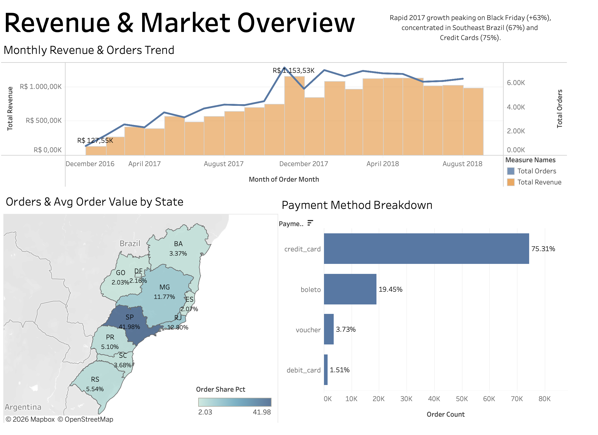
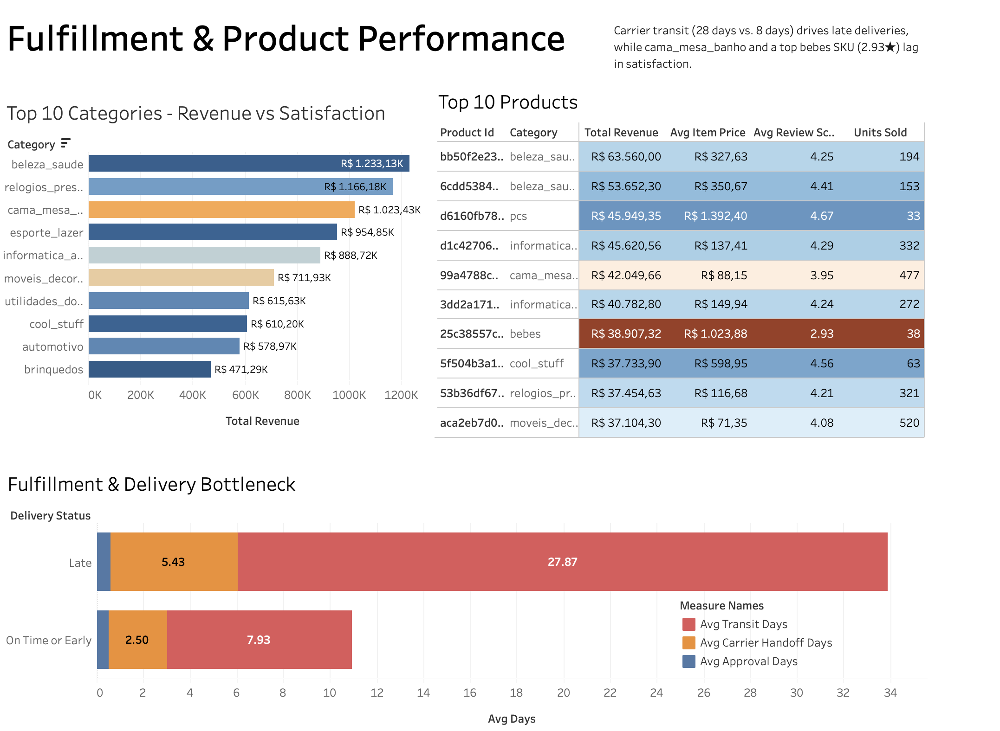
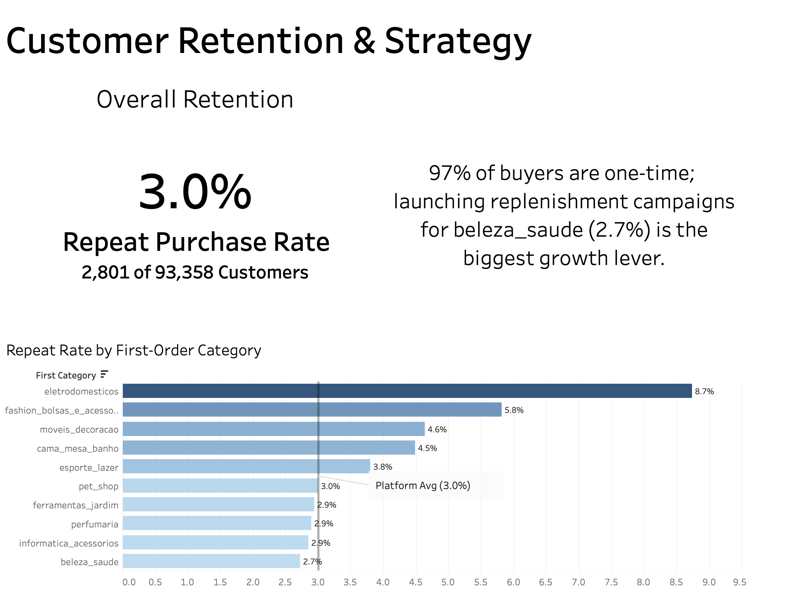

# Olist eCommerce SQL & Tableau Analysis

End-to-end SQL (MySQL) and Tableau analysis of 96K+ Brazilian eCommerce orders from the Olist dataset, evaluating fulfillment performance, top products, customer behavior, revenue trends, and retention drivers.
**[Dataset acquired from Kaggle](https://www.kaggle.com/datasets/olistbr/brazilian-ecommerce)**

**[View Interactive Dashboards on Tableau Public](https://public.tableau.com/app/profile/eugenia5101/viz/OlisteCommerce/CXRetentionStrategy)**

---

## Key Findings & Visualizations

### 1. Revenue & Market Overview

* **Seasonality & Growth:** Orders scaled nearly 10x from Jan 2017 (750) to a **Nov 2017 Black Friday peak** (7,289 orders, R$ 1.15M revenue, +62.8% MoM order growth) before stabilizing at 6,100–7,000 orders/month in 2018.
* **Geographic Concentration:** Three Southeast states—**SP (41.98%)**, **RJ (12.80%)**, and **MG (11.77%)**—drive **66.55%** of delivered orders, though SP has the lowest AOV (R$ 142.48) among top states.
* **Payment Preferences:** **Credit cards (75.31%)** and **boleto (19.45%)** account for ~95% of orders; **77.26%** of payment value occurs on weekdays.

---

### 2. Fulfillment & Product Performance

* **Delivery Bottleneck:** While **93%** of delivered orders arrive on time or early, late orders spend an average of **27.87 days in carrier transit** compared to **7.93 days** for on-time orders.
* **Shipping Impact on Reviews:** Orders averaging **11 days** receive 5-star reviews, whereas **21-day** deliveries average 1-star reviews.
* **Top Categories & Quality Flags:** `beleza_saude` leads revenue (R$ 1.23M, 4.22★), while `cama_mesa_banho` leads volume (10,953 units) with lower satisfaction (3.95★). At the SKU level, high-ticket `bebes` product `25c38557...` (R$ 38.9K) averages **2.93★**.

---

### 3. Customer Retention & Strategic Recommendations

* **Retention Gap:** Only **3.00%** of customers (2,801 of 93,358) placed more than one delivered order.
* **Category Retention:** `eletrodomesticos` (8.74%) and `fashion_bolsas_e_acessorios` (5.82%) lead repeat rates, whereas top-revenue consumable category `beleza_saude` sits below average at **2.73%**.

#### Recommendations
1. **Launch Replenishment Remarketing:** Trigger 30/60/90-day email campaigns and next-order vouchers for `beleza_saude`, `perfumaria`, and `pet_shop`.
2. **Audit Carrier Transit Outside SP:** Target carrier SLAs for non-SP routes and protect first-time buyers from late deliveries (5.71% late rate for repeat buyers vs. 6.84% for one-time buyers).
3. **Review Low-Rated High-Revenue SKUs:** Audit `cama_mesa_banho`, `moveis_decoracao`, and SKU `25c38557...` before featuring them in promotions.
4. **Optimize Campaign Timing & Payments:** Launch campaigns Monday–Thursday, promote credit card installments on high-ticket categories, and scale Q4 capacity ahead of November.

---

## Tools Used
* **SQL (MySQL 8.0):** CTEs, window functions (`SUM() OVER()`, `LAG()`, `ROW_NUMBER()`), `DATEDIFF`, multi-table joins
* **Tableau Public:** Dual-axis trends, filled geographic maps, highlight tables, and executive dashboards